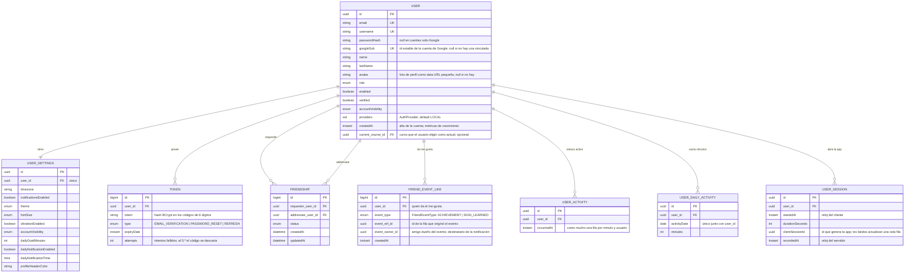
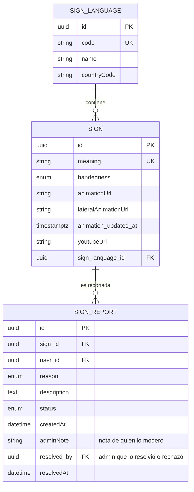
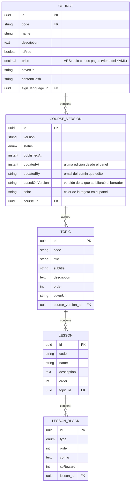
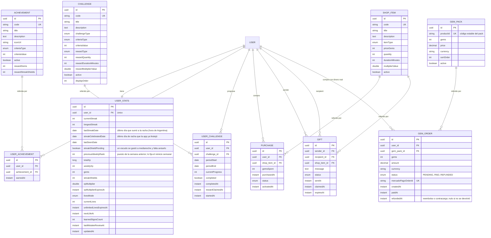
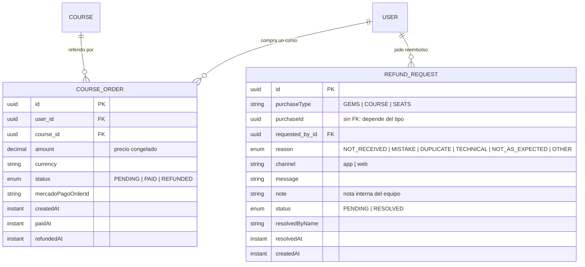
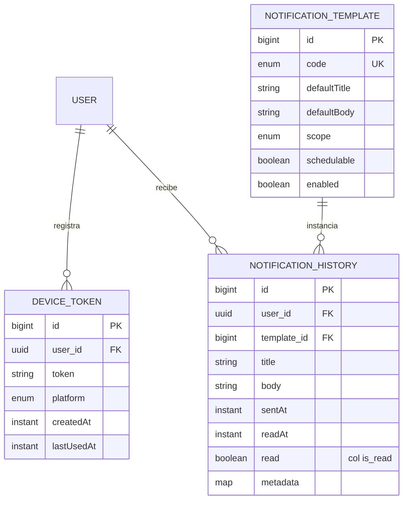
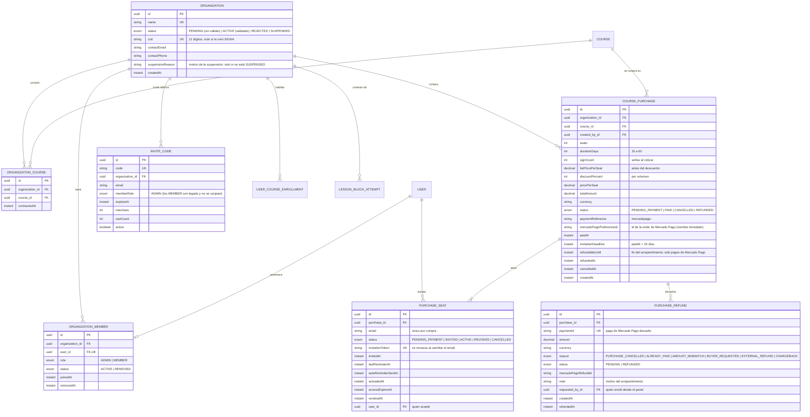
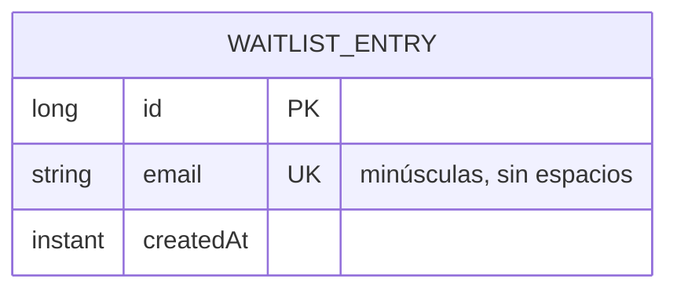
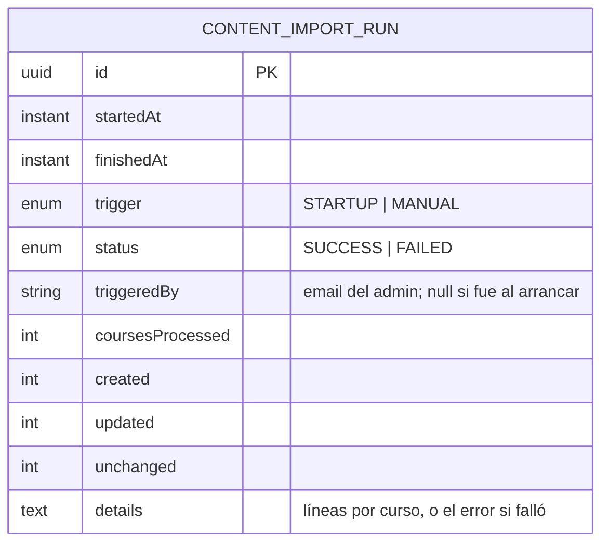

# Diagrama Entidad-Relación

Modelo de datos completo: las entidades del sistema y sus relaciones. Se agrupa en vistas
temáticas para facilitar la lectura.

## Usuarios

Perfil, settings, tokens, amistades, los "me gusta" del feed social y la telemetría de uso
(actividad, minutos diarios y sesiones de la app).

Los eventos del feed social **no se almacenan**: se derivan al vuelo de los logros y las señas
aprendidas de cada amigo. Por eso `FRIEND_EVENT_LIKE` no apunta a una tabla de eventos sino a la
fila que originó el evento, mediante el par (`eventType`, `eventRefId`).

`USER_ACTIVITY` es el registro de «quién estuvo activo»: la API escribe una fila (limitada a una por
minuto y usuario) cuando alguien autenticado hace cualquier pedido, y las métricas de usuarios
activos cuentan usuarios distintos sobre ella. `USER_DAILY_ACTIVITY` guarda los minutos de uso por
día que reporta la app, y `USER_SESSION` cada sesión de primer plano (la app la actualiza con un
latido cada 30 s). Las cuentas `ADMIN` se excluyen de las métricas.

## Señas

Catálogo de señas por lengua y sus reportes. `SIGN_REPORT.user_id` referencia a `USER` (vista
[Usuarios](#usuarios)). `SIGN.animationUrl` guarda el identificador (*key*) del objeto de animación
en el almacenamiento, no una URL. Los clientes piden la URL pública del archivo (con un
cache-buster) a la API, que además busca en el almacenamiento las señas que el catálogo no tiene o
tiene sin archivo (ver [Resolución de la animación de una seña](sequence.md#resolucion-de-la-animacion-de-una-sena)).
La extensión del key dice el formato (`.glb` avatar 3D o `.mp4` video). `SIGN.lateral_animation_url` es el video lateral de una seña en `.mp4` (null en las `.glb`). `SIGN.animation_updated_at` es la
última subida desde el panel de admins (null = archivo original del import) y sirve de cache-buster en
`POST /signs/media`. Los bloques y `USER_LEARNED_SIGN` referencian la seña por su `meaning` (texto), por
eso renombrarla desde el panel reescribe esas filas.

## Contenido / aprendizaje

Cursos, versiones y su jerarquía. `COURSE.sign_language_id` referencia a `SIGN_LANGUAGE` (vista
[Señas](#senas)).

## Progreso / seguimiento

Registro del avance de cada usuario sobre la jerarquía de contenido, más el XP diario y las señas
aprendidas. `USER` es la vista [Usuarios](#usuarios); `COURSE_VERSION`, `TOPIC`, `LESSON` y
`LESSON_BLOCK`, la vista [Contenido / aprendizaje](#contenido-aprendizaje). `USER_LEARNED_SIGN.sign`
guarda la seña como texto (no es FK a `SIGN`).

`PRACTICE_ATTEMPT` registra los intentos de la práctica libre (por tipo de ejercicio, por seña
aprendida o repaso de errores) — mismo shape que `LESSON_BLOCK_ATTEMPT` pero deliberadamente
separada: guardarla **no** cuesta vidas ni avanza `USER_LESSON_PROGRESS`/`USER_TOPIC_PROGRESS`.
Lo único que dispara es el XP del ejercicio, que se otorga al instante al acertar (ver [`PracticeService`](../../src/main/java/com/signasource/signa_api/learning/service/PracticeService.java)).
El repaso de errores lee de ambas tablas: un bloque es un "error pendiente" si su intento más
reciente (en cualquiera de las dos) fue incorrecto. `USER_STATS.lastMistakeReviewAt` marca el último
cobro del XP del repaso de errores: un nuevo cobro exige un error resuelto después de esa fecha.

```mermaid
erDiagram
    USER ||--o{ USER_COURSE_ENROLLMENT : "se inscribe"
    USER ||--o{ USER_TOPIC_PROGRESS : "avanza"
    USER ||--o{ USER_LESSON_PROGRESS : "avanza"
    USER ||--o{ LESSON_BLOCK_ATTEMPT : "intenta"
    USER ||--o{ PRACTICE_ATTEMPT : "practica"
    USER ||--o{ USER_DAILY_XP : "acumula"
    USER ||--o{ USER_LEARNED_SIGN : "aprende"
    COURSE_VERSION ||--o{ USER_COURSE_ENROLLMENT : "referida por"
    COURSE_VERSION ||--o{ USER_LEARNED_SIGN : "referida por"
    TOPIC ||--o{ USER_TOPIC_PROGRESS : "referido por"
    LESSON ||--o{ USER_LESSON_PROGRESS : "referida por"
    LESSON_BLOCK ||--o{ LESSON_BLOCK_ATTEMPT : "referido por"
    LESSON_BLOCK ||--o{ PRACTICE_ATTEMPT : "referido por"

    USER_COURSE_ENROLLMENT {
        uuid id PK
        uuid user_id FK
        uuid course_version_id FK
        uuid organization_id FK "nulo si es autoinscripción"
        enum status
        instant startedAt
        instant completedAt
        instant accessExpiresAt
    }
    USER_TOPIC_PROGRESS {
        uuid id PK
        uuid user_id FK
        uuid topic_id FK
        enum status
        instant startedAt
        instant completedAt
    }
    USER_LESSON_PROGRESS {
        uuid id PK
        uuid user_id FK
        uuid lesson_id FK
        enum status
        instant startedAt
        instant completedAt
        int xpEarned
    }
    LESSON_BLOCK_ATTEMPT {
        uuid id PK
        uuid user_id FK
        uuid lesson_block_id FK
        uuid organization_id FK "nulo si el curso no es de una organización"
        boolean isCorrect
        instant attemptedAt
    }
    PRACTICE_ATTEMPT {
        uuid id PK
        uuid user_id FK
        uuid lesson_block_id FK
        boolean isCorrect
        instant attemptedAt
    }
    USER_DAILY_XP {
        uuid id PK
        uuid user_id FK
        date xpDate
        int xpEarned
    }
    USER_LEARNED_SIGN {
        uuid id PK
        uuid user_id FK
        string sign
        uuid course_version_id FK
        instant learnedAt
    }
```

## Gamificación

`USER_STATS` es el inventario/estado del jugador (gemas, escudos de racha, vidas, multiplicador de XP,
rachas y XP). `ACHIEVEMENT` es el catálogo de logros; `USER_ACHIEVEMENT` registra los que un usuario
desbloqueó (con `earnedAt`). `SHOP_ITEM` es el catálogo de la tienda (multiplicadores de XP, vidas
ilimitadas por tiempo, recargas de vida, escudos de racha y el cofre sorpresa); `PURCHASE` es el
historial de compras (para uno mismo o al comprar un regalo) y `GIFT` el regalo enviado a un amigo,
pendiente de reclamar. `GEM_PACK` es el catálogo de packs de gemas que se compran con dinero real a través de Mercado Pago
(cada uno trae cuánta gema entrega y su precio en pesos); `GEM_ORDER` es cada intento de compra de un
pack: congela gemas y precio, guarda la order de Mercado Pago que la cobra y recién pasa a `PAID`
(y acredita) cuando Mercado Pago confirma el pago. La tabla vieja `gem_purchases` (comprobantes de
Google Play) ya no se usa.

## Compras de usuarios finales y pedidos de reembolso

Además de las gemas (`GEM_ORDER`, vista [Gamificación](#gamificacion)), un usuario puede comprar
**acceso permanente** a un curso pago con un pago único de Mercado Pago: `COURSE_ORDER` es el espejo de
`GEM_ORDER` (precio congelado al crear la orden, `PAID` solo cuando Mercado Pago confirma, `REFUNDED`
si se devuelve). Al pagarse se crea o reactiva una inscripción permanente (sin organización y sin
vencimiento). Convive con la compra por cupos de las organizaciones.

`REFUND_REQUEST` es el pedido que una persona (o un admin de organización) le hace al equipo para que
se le devuelva una compra; sirve para gemas, cursos individuales y cupos. **No devuelve nada por sí
solo**: es una señal que el equipo revisa y ejecuta en Mercado Pago. Como la compra vive en tablas
distintas según el tipo, se la identifica con el par (`purchaseType`, `purchaseId`) y no hay clave
foránea.

## Notificaciones

## Organizaciones

Una organización compra **cupos** por curso (`COURSE_PURCHASE`): cuántos, por cuántos días de acceso
(15 a 60) y a qué precio (precio de lista por cupo = (base + precio por seña × señas del curso) ×
(días / 30)^0,85, menos un descuento por volumen; ver `PurchasePricing`). Se paga con Mercado Pago
Checkout Pro. Un pago aprobado que no puede pagar la compra (cancelada, ya pagada por otro pago o
de otro monto) se devuelve completo y queda en `PURCHASE_REFUND`. Cada compra es independiente: tiene su propio pago, su ventana de invitación (10
días desde el pago) y sus cupos (`PURCHASE_SEAT`), cada uno atado a un email. Al aceptar la
invitación arrancan los días de esa persona (`activatedAt` → `accessExpiresAt`). Los estados
`INVITATION_EXPIRED` y `ACCESS_EXPIRED` no se guardan: se derivan de las fechas. `ORGANIZATION_COURSE`
queda como el registro de cursos que la organización compró alguna vez (lo crea el primer pago) y es
lo que usan las métricas del panel.

Un usuario pertenece a una sola organización: al salir la membresía queda como `REMOVED` (no se
borra), sus inscripciones a cursos pagos pasan a `DROPPED` y sus cupos activos a `REVOKED`; el
progreso se conserva. Si la persona da de baja su cuenta, sus cupos quedan con el email anonimizado (`erased-{id}@invalid`). `INVITE_CODE` solo se usa para invitar administradores al panel (los códigos
compartidos de participantes se eliminaron). Los intentos de ejercicio hechos sobre cursos de la
organización se etiquetan con ella para separar esa actividad de la propia del usuario.

## Lista de espera

## Importación de contenido

Bitácora de cada corrida del pipeline de importación de contenido (al arrancar o a demanda desde el
panel). No tiene relaciones: es un registro de auditoría independiente.

