# Diagramas de secuencia

Flujos dinámicos de los casos de uso principales, descritos a nivel de responsabilidades (no de
componentes concretos del código).

## Registro de usuario

```mermaid
sequenceDiagram
    autonumber
    participant C as Cliente
    participant API as API
    participant DB as Base de datos
    participant Mail as Servicio de correo

    C->>API: Solicitud de registro
    API->>DB: ¿Correo o usuario ya registrados?
    alt ya existe
        API-->>C: Conflicto (409)
    else disponible
        API->>DB: Crear cuenta (activa, correo sin verificar, contraseña cifrada), sus stats con las vidas llenas y sus ajustes (con la meta diaria de la encuesta inicial, si vino)
        API->>DB: Generar código de verificación de 6 dígitos (cifrado)
        API->>Mail: Enviar correo de verificación
        API->>API: Emitir token de acceso
        API->>DB: Generar token de renovación
        API-->>C: Registro exitoso + tokens (sesión iniciada; verificar correo es opcional)
    end
```

## Inicio de sesión

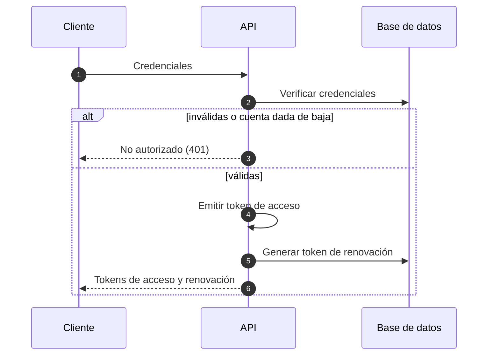

## Petición autenticada

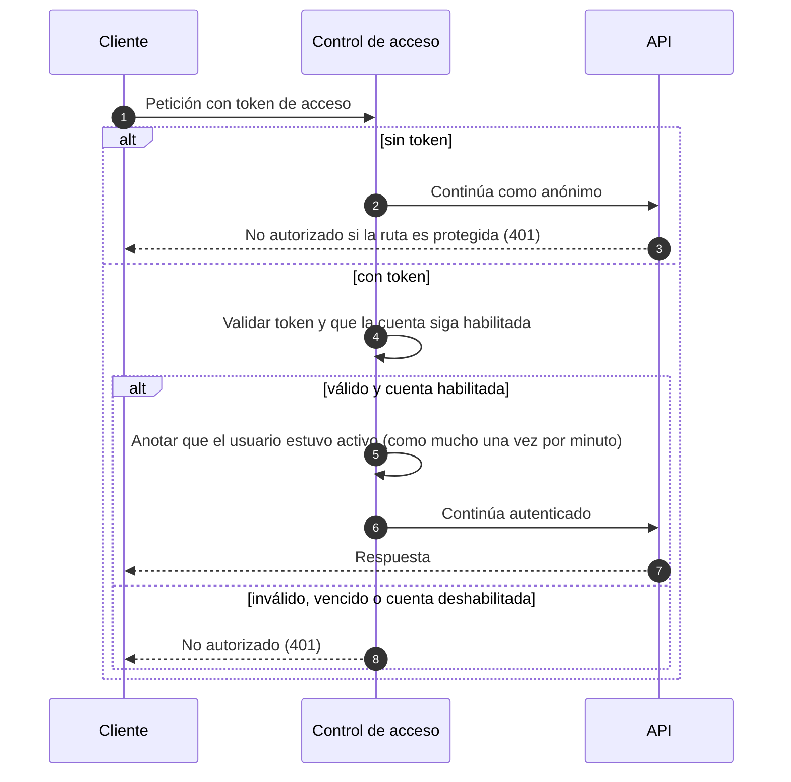

## Renovación de token (rotación)

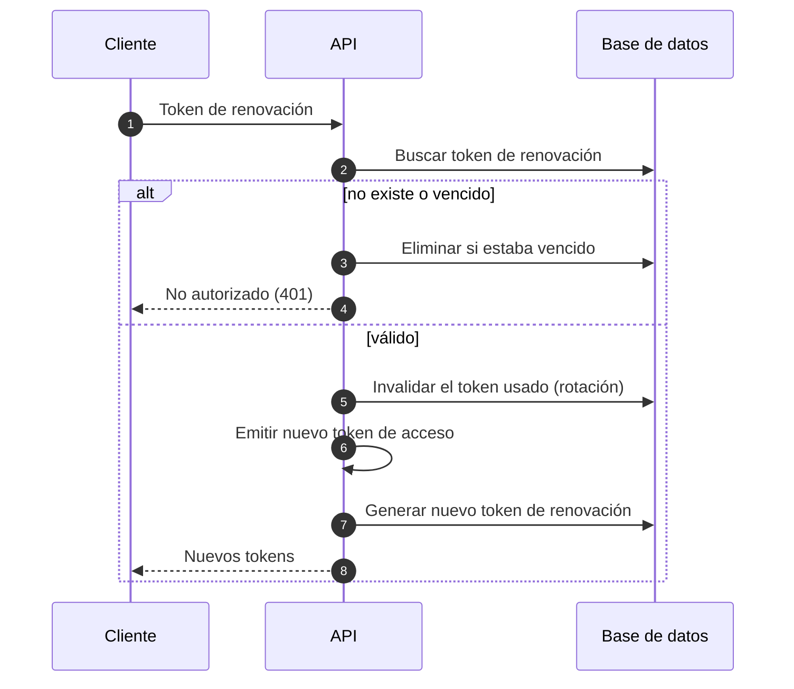

## Restablecimiento de contraseña con código

El correo trae un código de 6 dígitos que vence a los 15 minutos; se guarda cifrado (BCrypt) y se
descarta tras 5 intentos fallidos. Pedirlo responde igual exista o no la cuenta, y cualquier código
inválido, vencido o agotado devuelve el mismo error.

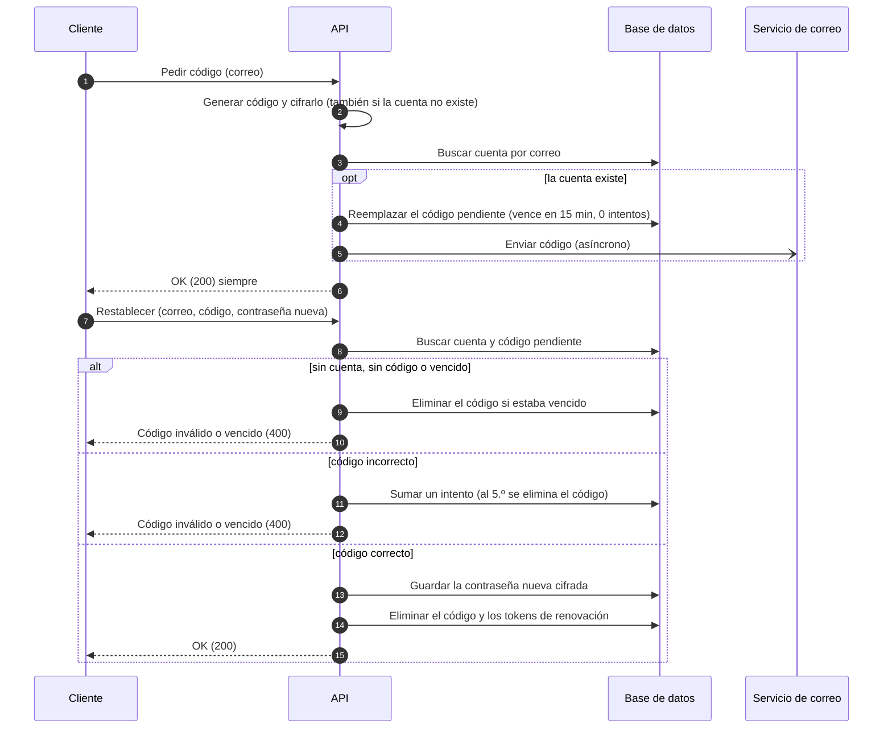

## Inicio de sesión con proveedor externo

La cuenta se reconoce por el identificador estable del proveedor y, si no, por el correo. Solo se
acepta un correo que el proveedor haya verificado. Si la cuenta es nueva, la meta diaria de la
encuesta inicial se aplica al crearla; si ya existía, se ignora. Una persona que ya tiene cuenta
también puede **vincular** una cuenta de Google (aunque tenga otro correo) desde su perfil: da
conflicto si ya tiene una vinculada o si esa cuenta de Google ya es de otra persona.

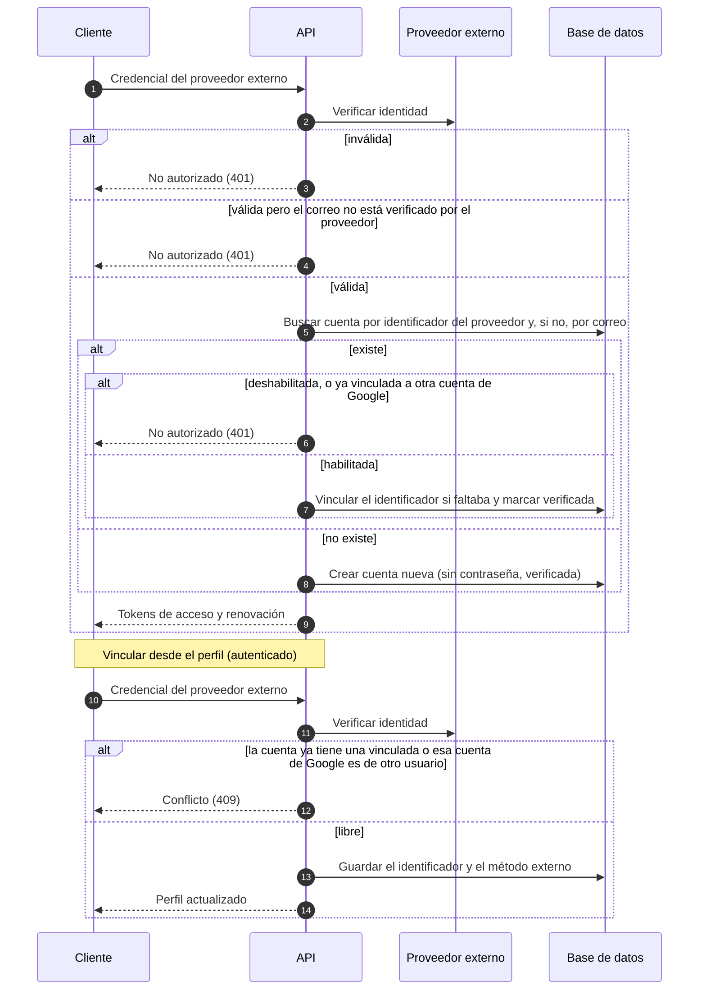

## Envío de notificación push

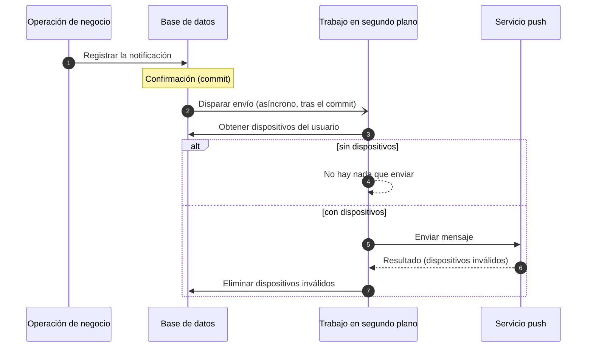

## Búsqueda de personas para agregar

La búsqueda resuelve cada resultado **contra quien busca**: devuelve ya la relación que los une y
cuántas amistades tienen en común, para que el cliente pueda dibujar la acción correcta (agregar,
aceptar, cancelar, desbloquear) sin una segunda consulta. A quien haya bloqueado al que busca no se
lo muestra.

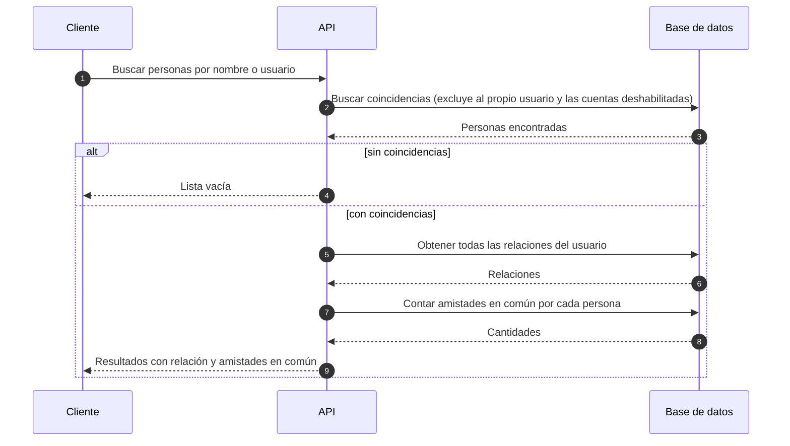

## Feed social y "me gusta"

Los eventos del feed no se almacenan: se derivan de los logros y las señas aprendidas de los amigos,
y se identifican por el tipo de evento más la fila que lo originó. Un "me gusta" se guarda contra ese
par y avisa al dueño del evento; repetirlo no hace nada, así que no se notifica dos veces.

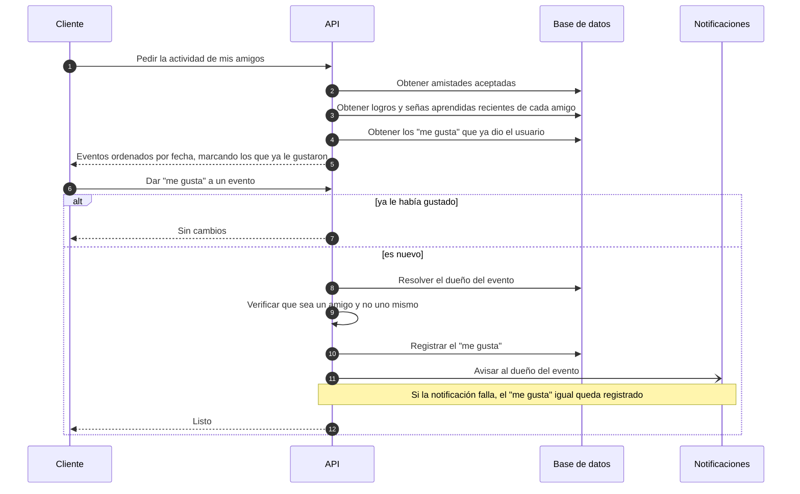

## Perfil público de otra persona

Una sola consulta arma toda la pantalla de perfil ajeno. Se excluye a propósito lo que es "billetera"
del usuario (gemas, vidas, potenciadores): sólo viaja progreso. Una cuenta privada que no es amiga de
quien mira **no da error**: devuelve identidad y relación, para que igual se le pueda mandar una
solicitud, y nada de progreso.

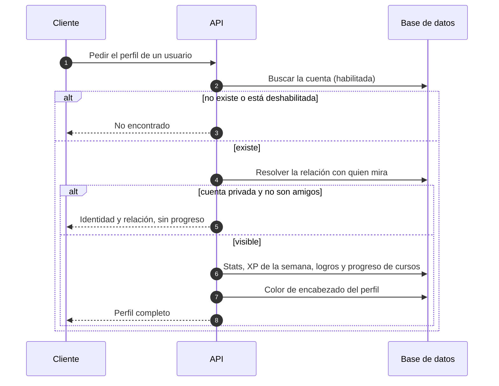

## Consulta de logros e inventario

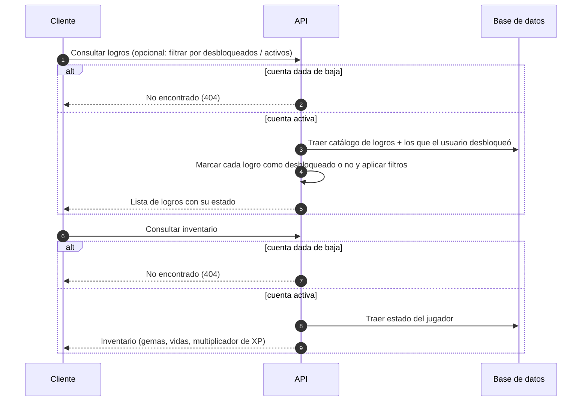

## Consulta de progreso de cursos

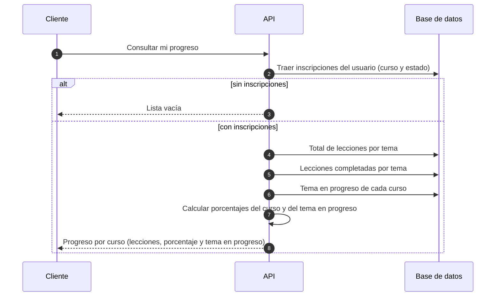

## Recorrido de un curso (roadmap)

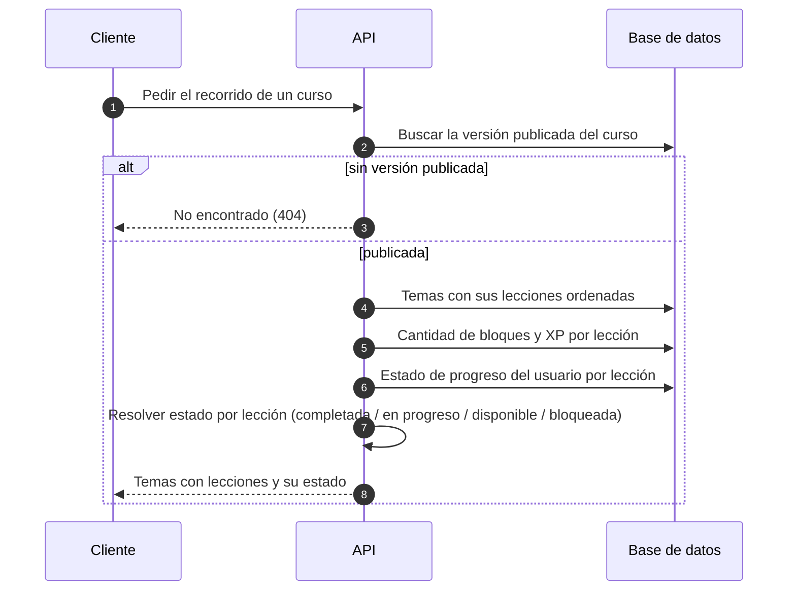

## Inscripción a un curso

Por cuenta propia solo se accede a cursos gratuitos. Un curso pago se obtiene por una organización
(ver [Aceptación de una invitación](#aceptacion-de-una-invitacion)) o comprándolo uno mismo (ver
[Compra individual de un curso pago](#compra-individual-de-un-curso-pago)).

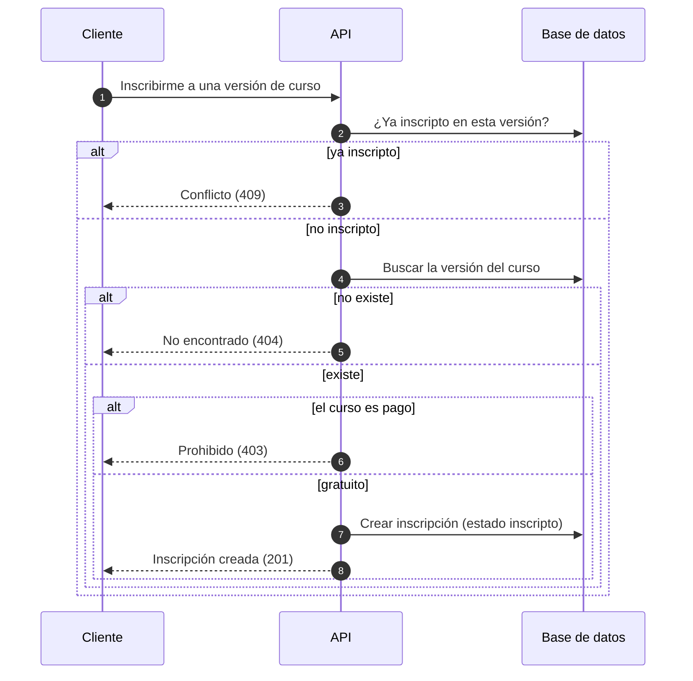

## Interacción con un bloque de lección

Registra el intento del usuario y propaga la finalización hacia arriba en la jerarquía
(lección → tema → curso). El XP y demás recompensas de gamificación se disparan por eventos, fuera
del camino principal. El progreso de lección y tema se crea de forma diferida en la primera
interacción.

**Bloques requeridos para completar la lección:** todos salvo `INTRODUCE_SIGN` e `INVISIBLE_SIGNS`,
que el reproductor de la app nunca reporta (el primero solo presenta la seña, el segundo no se
muestra). `INFO` y los de cámara (`PERFORM_SIGN`, `SPELL_NAME`) cuentan con cualquier intento; el
resto pide un acierto. La finalización se evalúa en **cada** interacción (no solo en el primer
hito), así una lección que quedó en progreso se completa al volver a responder cualquiera de sus
bloques.

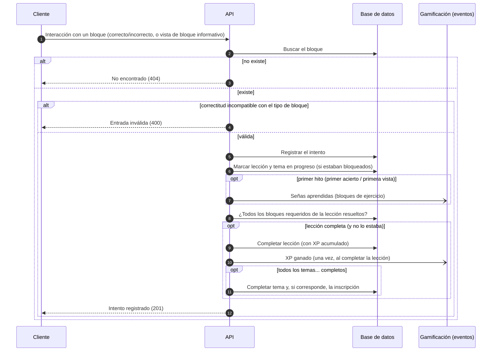

## Práctica libre

Sesiones sueltas de repaso (por tipo de ejercicio, por seña aprendida, o de errores pendientes),
fuera del camino de una lección real. Reutiliza los mismos `LESSON_BLOCK` de las lecciones en las
que el usuario está inscripto, pero el intento se guarda en `PRACTICE_ATTEMPT`, no en
`LESSON_BLOCK_ATTEMPT` — no cuesta vidas y no toca el progreso de lección/tema/curso
(contraste con [Interacción con un bloque de lección](#interaccion-con-un-bloque-de-leccion)). El
repaso de errores combina ambas tablas: un bloque es un "error pendiente" si su intento más
reciente, en cualquiera de las dos, fue incorrecto.

Solo se practican bloques evaluables (se excluyen `INFO`, `INTRODUCE_SIGN`, `INVISIBLE_SIGNS`,
`PERFORM_SIGN` y `SPELL_NAME`) y solo de lecciones que el usuario ya empezó (`USER_LESSON_PROGRESS`).

**XP por ejercicio:** a diferencia de las lecciones (cuyo XP se paga una sola vez al completar la
lección entera), cada ejercicio de práctica acertado otorga su XP **al instante** (evento
`XpEarnedEvent`, que también actualiza la racha). Un intento incorrecto o un bloque sin XP no suma.

**Excepción:** terminar un lote de repaso de errores puede otorgar una recompensa de XP fija
(`PracticeService.completeMistakeReview`, evento `XpEarnedEvent`). Se otorga solo si, desde el último
cobro (`USER_STATS.last_mistake_review_at`), el usuario respondió bien un bloque que antes había fallado;
si no, devuelve 0 XP. Así no se puede farmear contestando mal a propósito.

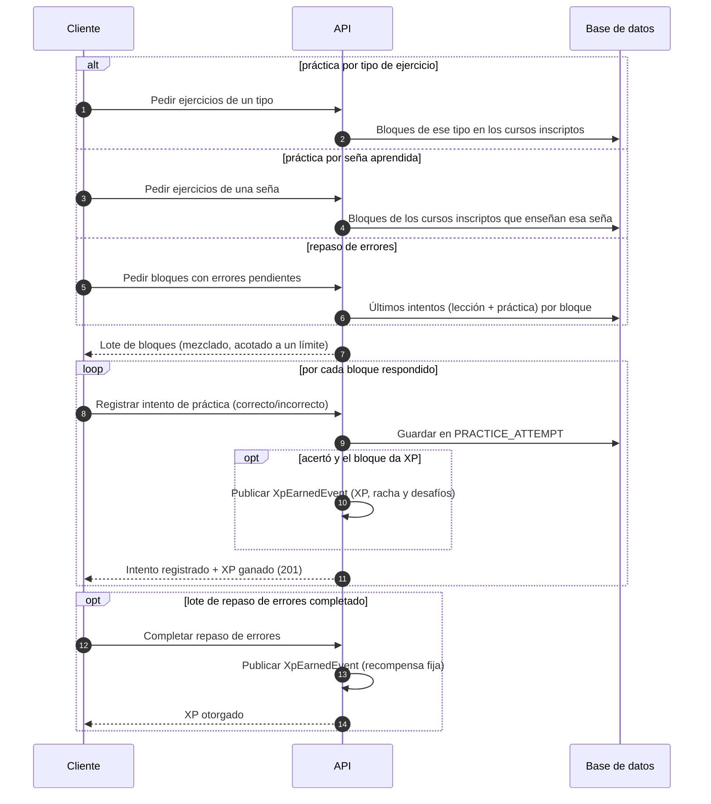

## Tienda: compra para uno mismo o como regalo

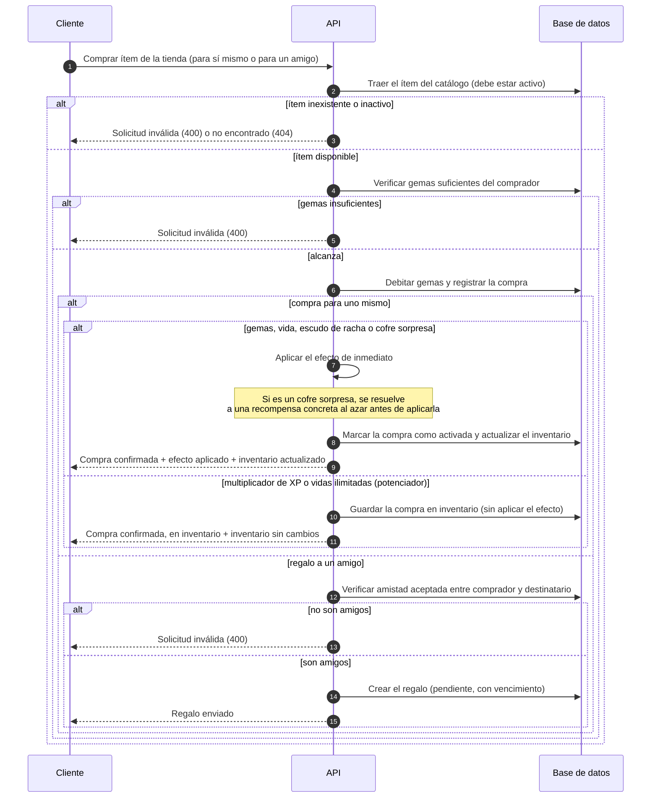

## Alta y validación de una organización

Una empresa se registra desde la web sin comprar nada: se crean en un solo paso la cuenta de su
administrador y la organización, pendiente de validación. SIGNA verifica que quien la registró
represente a la organización y la aprueba (o la rechaza); recién validada puede comprar cupos.

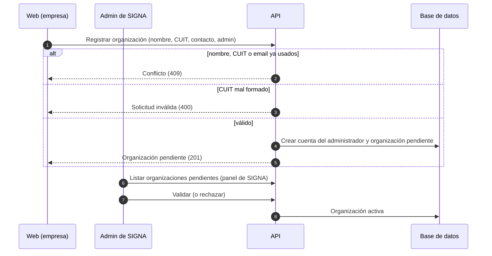

## Compra de cupos

La organización elige un curso (viendo las señas que incluye, por módulo), la duración (5 a 60
días) y carga un email por cupo. El panel le muestra un resumen (curso, señas, cupos, días, precio de
lista, descuento por volumen y total) y, al confirmar, crea la compra pendiente de pago y la manda a
Mercado Pago Checkout Pro. El pago se acredita solo después de releerlo en la API de Mercado Pago, por
el webhook o por el sync que hace el panel al volver (lo que llegue primero; la confirmación es
idempotente). `PurchasePaymentService.confirmPayment` abre la ventana de 10 días y manda una
invitación personal a cada email. Un pago aprobado que no puede pagar la compra se reembolsa solo.
Cancelar la compra (solo antes del pago) cancela también la order de Mercado Pago. Ya no existe la
confirmación manual desde el back-office: el único camino para marcar una compra como pagada es
Mercado Pago.

```mermaid
sequenceDiagram
    autonumber
    participant A as Admin de la organización
    participant MP as Mercado Pago
    participant API as API
    participant M as Correo
    participant DB as Base de datos

    A->>API: Catálogo
    API-->>A: Cursos con sus señas por módulo y descuentos por volumen
    A->>API: Cotizar (curso, cupos, días)
    API-->>A: Precio de lista, descuento, precio por cupo y total
    A->>API: Comprar (curso, días, emails)
    alt organización sin validar, curso gratuito, duración fuera de rango o email repetido
        API-->>A: Solicitud inválida (400)
    else un email ya tiene un cupo vigente o pendiente de ese curso
        API-->>A: Conflicto (409)
    else válido
        API->>DB: Compra pendiente de pago + un cupo por email
        API-->>A: Compra creada (201)
    end
    A->>API: Pagar la compra
    API->>MP: Crear order de Checkout Pro (external_reference = compra, cupos × precio por cupo)
    MP-->>API: checkoutUrl
    API-->>A: checkoutUrl
    A->>MP: Paga en Checkout Pro
    par webhook
        MP->>API: Notificación de la order (x-signature)
        API->>API: Verificar firma (403 si no coincide)
    and vuelta al panel
        MP-->>A: Redirige a /dashboard/purchases/{id}?pago=…&payment_id=…
        A->>API: Sincronizar pago (sin body: usa la order guardada en la compra)
    end
    API->>MP: Releer la order
    MP-->>API: Estado, external_reference, monto, moneda
    alt aprobado, compra pendiente y mismo total
        API->>DB: Lock de la compra; pagada (mercadopago:<id>)
    else aprobado pero la compra está cancelada, ya pagada por otro pago o el total no coincide
        API->>DB: Reembolso PENDING (único por pago)
        API->>MP: Reembolsar el pago completo (idempotente)
        API->>DB: Reembolso REFUNDED
        Note over API,MP: si Mercado Pago falla queda PENDING y el 503 hace reintentar el webhook
    else rechazado o pendiente
        API-->>A: Estado del pago, la compra sigue pendiente
    end
    API->>DB: Vence la invitación a los 10 días
    API->>DB: Registrar el curso como contratado (si es el primero)
    API->>DB: Token nuevo por cupo
    API-)M: Invitación personal a cada email (al confirmar la transacción)
```

## Anulación de una compra pagada

Dentro de los 10 días del pago (arrepentimiento) la organización puede anular una compra pagada con
Mercado Pago. Primero se registra el reembolso como pendiente, después se devuelve en Mercado Pago y
recién entonces se revoca la compra; si Mercado Pago falla, el reembolso queda pendiente y se
completa al reintentar o cuando llega la notificación del pago devuelto. Un reembolso hecho desde
Mercado Pago o un contracargo revocan la compra en cualquier momento.

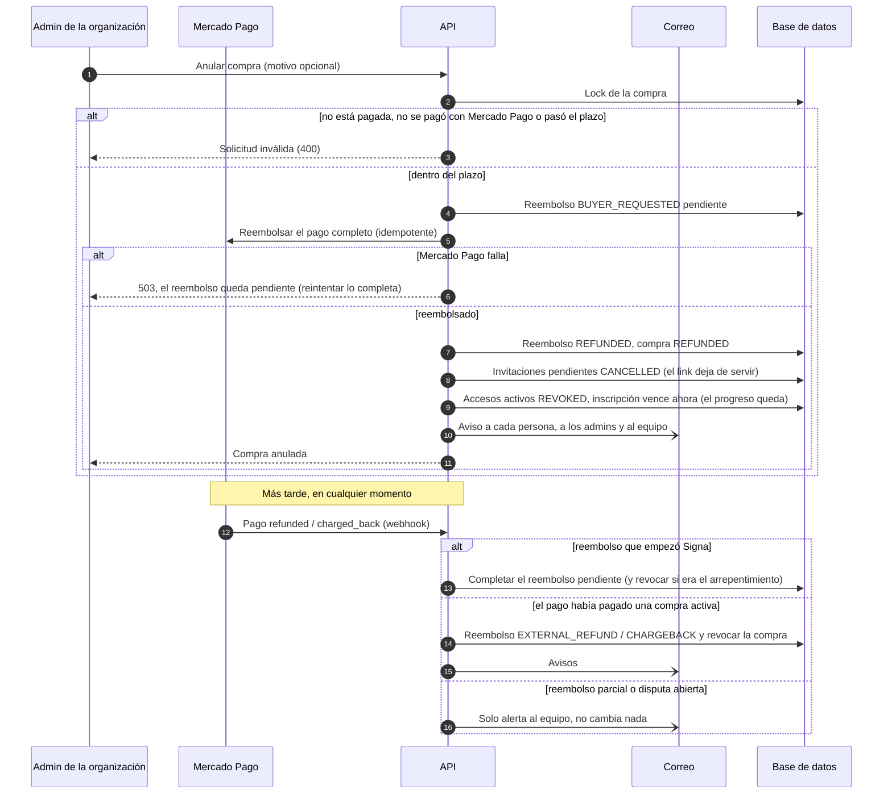

## Aceptación de una invitación

El link del correo lleva a la web. La persona crea su cuenta o inicia sesión **con el mismo email** y
acepta; desde ese momento corren sus días de acceso. El link es la prueba de que el email es suyo,
así que la cuenta queda verificada. Al día 5 sin aceptar sale un recordatorio automático (job
horario); la organización puede mandar recordatorios manuales (uno cada 24 h) y cambiar el email
mientras no se aceptó: eso invalida el link anterior y manda uno nuevo, sin correr el vencimiento.

```mermaid
sequenceDiagram
    autonumber
    participant U as Empleado (web)
    participant API as API
    participant DB as Base de datos

    U->>API: Ver la invitación (token)
    API-->>U: Organización, curso, email, estado, vencimiento, si ya tiene cuenta
    U->>API: Registrarse o iniciar sesión con ese email
    U->>API: Aceptar (token)
    alt token inexistente o reemplazado
        API-->>U: No encontrado (404)
    else otro email
        API-->>U: Prohibido (403)
    else vencida, revocada o la organización no está activa
        API-->>U: Solicitud inválida (400)
    else pertenece a otra organización
        API-->>U: Conflicto (409)
    else válida
        API->>DB: Crear o reactivar la membresía (MEMBER)
        API->>DB: Inscribir con vencimiento = hoy + días (conserva progreso previo)
        API->>DB: Cupo activo, cuenta verificada
        API-->>U: Curso habilitado y fecha de vencimiento
    end
    Note over API,DB: Al vencer, las lecciones se bloquean; el progreso queda visible para el empleado y la organización
```

## Invitación de un administrador al panel de la organización

Un admin de SIGNA invita por email a quien va a administrar la organización desde el panel web. El
correo lleva al panel; la persona crea su cuenta o inicia sesión y acepta la invitación, con lo que
pasa a administrar esa organización (y solo esa).

```mermaid
sequenceDiagram
    autonumber
    participant S as Admin de SIGNA
    participant API as API
    participant M as Correo
    participant P as Panel web
    participant DB as Base de datos

    S->>API: Invitar administrador (email)
    API->>DB: Guardar invitación de un solo uso atada al email, con rol administrador
    API-)M: Enviar enlace al panel con el código
    M-->>P: La persona abre el enlace
    P->>API: Registrarse o iniciar sesión
    P->>API: Aceptar invitación (código)
    API->>DB: Buscar código
    alt inexistente, vencido, usado o de otro correo
        API-->>P: Solicitud inválida (400)
    else pertenece a otra organización
        API-->>P: Conflicto (409)
    else válido
        API->>DB: Crear o promover la membresía como administradora
        API-->>P: Organización y rol
    end
```

## Tienda: compra de gemas con dinero real (Mercado Pago)

La app nunca acredita gemas por su cuenta: la API crea una orden en Mercado Pago, la app abre el
checkout y las gemas se acreditan sólo cuando la API lee la orden desde Mercado Pago y la ve
aprobada, con el monto esperado. Dos caminos llegan a ese punto —el webhook y el chequeo que hace la
app al volver— y la orden queda bloqueada, así que no se acredita dos veces.

```mermaid
sequenceDiagram
    autonumber
    participant C as Cliente
    participant API as API
    participant MP as Mercado Pago
    participant DB as Base de datos

    C->>API: Listar packs de gemas
    API-->>C: Packs (gemas + precio en pesos)
    C->>API: Comprar un pack
    API->>DB: Crear la orden (PENDING, gemas y precio congelados)
    API->>MP: Crear order de checkout
    MP-->>API: Id de la order + URL de pago
    API-->>C: Id de orden + URL de pago
    C->>MP: Abrir el checkout y pagar
    MP-->>API: Webhook (tema order)
    API->>MP: Releer la order
    MP-->>API: Estado, monto y moneda
    API->>DB: Orden bloqueada: si está aprobada y coincide, PAID y acreditar gemas
    MP-->>C: Volver a la app (página de la API + deep link)
    C->>API: Verificar la orden
    API->>MP: Releer la order
    API->>DB: Mismo paso; si ya estaba PAID no acredita de nuevo
    API-->>C: Estado de la orden + inventario
```

## Obtención de la animación de una seña (URL firmada)

Es el camino de `GET /signs/{meaning}/animation` y de su variante por lote. Para mostrar señas, las
apps usan hoy la [resolución por URL pública](#resolucion-de-la-animacion-de-una-sena). La API firma una URL de descarga temporal contra el almacenamiento de objetos usando sus
credenciales privadas; el cliente nunca las recibe, sólo la URL, que expira a los pocos minutos. El
archivo se descarga directamente desde el almacenamiento, sin pasar por la API.

```mermaid
sequenceDiagram
    autonumber
    participant C as Cliente
    participant API as API
    participant DB as Base de datos
    participant OS as Almacenamiento de objetos

    C->>API: Solicitar la animación de una seña
    API->>DB: Buscar la seña
    alt no existe
        API-->>C: No encontrado (404)
    else existe
        alt sin animación asociada
            API-->>C: No encontrado (404)
        else con animación
            API->>OS: Firmar una URL temporal de descarga
            API-->>C: URL temporal (expira en minutos)
            C->>OS: Descargar el archivo de animación
            OS-->>C: Archivo de animación
        end
    end
```

## Resolución de la animación de una seña

Las apps (web y mobile) le piden a la API, en un solo pedido, qué archivo mostrar para una lista de
señas; la API responde con la URL pública del bucket y el formato (`.glb` avatar 3D o `.mp4` video,
con su video lateral si existe), más un parámetro de versión que invalida la caché cuando el panel
reemplaza el archivo. El cliente no adivina nombres de archivo. Con `include_missing` la respuesta
incluye una entrada vacía por cada seña sin archivo, para que el cliente muestre su placeholder.

Si el catálogo no conoce la seña, o la tiene sin archivo (se registró antes de que se subiera), la API
la busca directamente en el bucket con las mismas reglas del importador: `.glb`, si no `.mp4` (más
lateral), con el nombre de la seña o su alias, sin distinguir mayúsculas ni acentos. El listado del
bucket y cada respuesta (incluso «no hay nada») se guardan 10 minutos. Así, subir un archivo a R2
alcanza para que la seña aparezca, sin correr el import.

```mermaid
sequenceDiagram
    autonumber
    participant C as Cliente
    participant API as API
    participant DB as Base de datos
    participant OS as Almacenamiento de objetos

    C->>API: Archivos de estas señas (lista, include_missing opcional)
    API->>DB: Buscar las señas del catálogo
    loop por cada seña pedida
        alt el catálogo tiene un archivo
            API->>API: URL pública + versión (cuándo se subió desde el panel)
        else no está o no tiene archivo
            API->>OS: Buscar en el listado en caché (o exacto si no se puede listar)
            alt aparece
                API->>API: URL pública del archivo encontrado
            else no hay archivo
                API->>API: Omitir (o entrada vacía si pidieron include_missing)
            end
        end
    end
    API-->>C: Lista de {seña, URL, formato, URL lateral}
    C->>OS: Descargar cada archivo (lectura pública, sin pasar por la API)
```

## Tienda: reclamar un regalo

```mermaid
sequenceDiagram
    autonumber
    participant C as Cliente (destinatario)
    participant API as API
    participant DB as Base de datos

    C->>API: Reclamar regalo recibido
    API->>DB: Buscar el regalo (debe pertenecer al destinatario)
    alt no encontrado
        API-->>C: No encontrado (404)
    else ya reclamado
        API-->>C: Conflicto (409)
    else vencido
        API->>DB: Marcar como expirado
        API-->>C: Solicitud inválida (400)
    else pendiente y vigente
        API->>API: Aplicar el efecto del ítem regalado (resolviendo el cofre sorpresa si corresponde)
        API->>DB: Actualizar el inventario del destinatario
        API->>DB: Marcar el regalo como reclamado
        API-->>C: Efecto aplicado + inventario actualizado
    end
```

## Reclamo y activación de un potenciador

Una compra de la tienda pasa por hasta tres estados: **pendiente** (regalo sin reclamar),
**en inventario** (el ítem ya es del usuario) y **activada** (ya se consumió). Una compra para uno
mismo de gemas, vida, escudo de racha o cofre sorpresa aplica el efecto al instante y nace ya
**activada**; si es un potenciador temporal (vidas ilimitadas o multiplicador de XP) nace
directamente **en inventario**, sin pasar por pendiente, a la espera de que el usuario la active. El
regalo a un amigo es el único camino que nace **pendiente**: el destinatario lo reclama primero (pasa
a **en inventario**) y luego, si es un potenciador, lo activa. Ambos pasos se piden por `item_type`
(no por id de compra), tomando siempre la compra más antigua de ese tipo en el estado esperado
(FIFO).

```mermaid
sequenceDiagram
    autonumber
    participant C as Cliente
    participant API as API
    participant DB as Base de datos

    C->>API: Reclamar compra (item_type)
    alt cuenta dada de baja o sin compra pendiente de ese tipo
        API-->>C: No encontrado (404)
    else compra pendiente encontrada
        API->>DB: Marcar la compra más antigua como "en inventario"
        API-->>C: Compra en inventario + estado del jugador
    end

    C->>API: Activar potenciador (item_type)
    alt cuenta dada de baja o sin compra en inventario de ese tipo
        API-->>C: No encontrado (404)
    else tipo de potenciador no soportado (p. ej. escudo de racha)
        API-->>C: Solicitud inválida (400)
    else compra en inventario de vidas ilimitadas o multiplicador de XP
        API->>DB: Traer inventario del jugador (USER_STATS)
        API->>API: Fijar el vencimiento del efecto (ahora + duración del ítem)
        API->>DB: Guardar inventario actualizado
        API->>DB: Marcar la compra como activada
        API-->>C: Estado del potenciador + inventario actualizado
    end
```

## Importación de contenido

El YAML del repositorio es la fuente de verdad. La importación corre al arrancar y también a pedido
desde el panel (solo `ADMIN`); cada corrida queda registrada con su resultado. Una falla se registra y
se muestra en el panel, pero **nunca** tira abajo la API al arrancar. Al final se refrescan las
claves de archivo de las señas contra el bucket, así que subir un archivo y reimportar basta.

```mermaid
sequenceDiagram
    autonumber
    participant P as Proceso de importación
    participant F as Archivos de contenido
    participant DB as Base de datos
    participant OS as Almacenamiento de objetos

    P->>DB: Registrar la corrida (al arrancar o manual, con quién la disparó)

    P->>F: Leer y validar cada curso
    alt algún curso inválido
        P-->>P: Se detiene, nada se escribe
        P->>DB: Corrida FAILED con el error
    else todos válidos
        loop por cada curso
            P->>DB: Comparar con lo guardado
            alt sin cambios
                P-->>P: Sin cambios
            else nuevo o modificado
                P->>DB: Crear o actualizar
            end
        end
        Note over P,DB: Catálogo de señas: solo de los cursos que cambiaron
        loop por cada seña que un bloque renderiza como animación
            alt ya existe en el catálogo
                P-->>P: Se conserva sin cambios
            else nueva
                P->>OS: Buscar su archivo (.glb, si no .mp4 y lateral)
                P->>DB: Crear la seña (apunta a su archivo de animación)
            end
        end
        P->>DB: Re-resolver las claves de archivo que siguen siendo las de por defecto
        P->>DB: Corrida SUCCESS con creados, actualizados y sin cambios
    end
```

## Compra individual de un curso pago

Un usuario compra **acceso permanente** a un curso pago con un único pago de Mercado Pago. Es el mismo
patrón que las gemas: el precio queda congelado en la orden y el acceso se otorga solo cuando la API
relee la order en Mercado Pago y la ve aprobada con el monto esperado (por el webhook compartido o por
el sync de la app). La referencia de la order distingue su tipo (gemas, curso o compra de cupos).

```mermaid
sequenceDiagram
    autonumber
    participant C as Cliente
    participant API as API
    participant MP as Mercado Pago
    participant DB as Base de datos

    C->>API: Comprar un curso
    alt curso gratuito, sin precio cargado o ya lo tiene
        API-->>C: Solicitud inválida (400)
    else disponible
        API->>DB: Crear la orden (PENDING, precio congelado)
        API->>MP: Crear order de checkout
        MP-->>API: Id de la order + URL de pago
        API-->>C: Id de orden + URL de pago
    end
    C->>MP: Pagar en el checkout
    MP-->>API: Webhook (tema order)
    API->>MP: Releer la order
    MP-->>API: Estado, monto y moneda
    API->>DB: Orden bloqueada: si está aprobada y coincide, PAID
    API->>DB: Crear o reactivar la inscripción permanente (sin organización, sin vencimiento)
    MP-->>C: Volver a la app
    C->>API: Verificar la orden
    API->>MP: Releer la order (idempotente: no otorga dos veces)
    API-->>C: Estado de la orden

    Note over MP,API: Más tarde, un reembolso o contracargo
    MP->>API: Pago refunded / charged_back
    API->>DB: Orden REFUNDED e inscripción DROPPED
```

## Pedido de reembolso

Una persona (desde la app) o el admin de una organización (desde el panel) puede pedir que se le
devuelva una compra pagada. Antes de ofrecerlo, el cliente consulta si es elegible. El pedido **no
devuelve nada**: queda para que el equipo lo revise y haga el reembolso en Mercado Pago (o, en el caso
de los cupos, con la anulación de la compra).

```mermaid
sequenceDiagram
    autonumber
    participant C as Cliente (app o panel)
    participant API as API
    participant DB as Base de datos
    participant A as Admin de SIGNA

    C->>API: ¿Esta compra es elegible para reembolso?
    API->>DB: Leer la compra y su estado
    API-->>C: Elegible o motivo (no pagada, ya reembolsada, gemas gastadas, primera lección completada, cupos aceptados)
    C->>API: Pedir el reembolso (motivo y mensaje)
    alt no elegible o ya hay un pedido pendiente
        API-->>C: Solicitud inválida (400)
    else válido
        API->>DB: Guardar el pedido (PENDING)
        API-->>C: Pedido creado (201)
    end
    A->>API: Listar y revisar los pedidos
    A->>API: Marcarlo como resuelto (con una nota)
    API->>DB: Pedido RESOLVED, con quién y cuándo
```

## Desafíos

Hay tres conjuntos: «Primeros pasos» (único), diarios y semanales. Las filas de cada usuario se crean
al consultarlos. Diarios y semanales recién aparecen cuando se reclamaron todos los primeros pasos. El
progreso lo reportan las acciones que ya ocurren (lección completada, práctica con cámara, XP, racha,
solicitud de amistad) y **no toca las stats**: la recompensa (gemas, multiplicador de XP, vida o
escudo) se acredita recién al reclamar.

```mermaid
sequenceDiagram
    autonumber
    participant C as Cliente
    participant API as API
    participant DB as Base de datos

    Note over C,API: Mientras el usuario juega
    API->>DB: Sumar progreso a los desafíos que corresponden

    C->>API: Consultar los desafíos
    API->>DB: Crear las filas del período que falten (hora de Argentina)
    API-->>C: Desafíos con su progreso

    C->>API: Reclamar la recompensa
    alt no completado o ya reclamado
        API-->>C: Solicitud inválida (400)
    else diario o semanal con el período vencido
        API-->>C: Solicitud inválida (400)
    else válido
        API->>DB: Acreditar la recompensa en las stats y marcar reclamado
        API-->>C: Desafío reclamado + stats
    end
```

## Racha, escudos y día de racha pendiente

Un día suma a la racha con la primera actividad que da XP. A medianoche (hora de Argentina) un proceso
programado revisa a quienes no la extendieron ayer: si tienen escudos suficientes para los días
perdidos los gasta y deja un aviso pendiente; si no, la racha vuelve a 0. La app consulta si hay un
día de racha sin festejar y lo marca como visto al mostrarlo.

```mermaid
sequenceDiagram
    autonumber
    participant S as Proceso diario (00:00 ART)
    participant API as API
    participant DB as Base de datos
    participant C as Cliente

    S->>DB: Usuarios con racha activa que no sumaron ayer
    alt tiene escudos para los días perdidos
        S->>DB: Gastar escudos, conservar la racha y marcar escudo pendiente
    else no alcanza
        S->>DB: Racha en 0
    end

    C->>API: ¿Hay un día de racha sin festejar?
    API->>DB: Leer la última fecha de racha y la última festejada
    API-->>C: Pendiente (sí o no) y racha actual
    C->>API: Marcar el día como visto (idempotente)
    API->>DB: Guardar la fecha festejada
```
