# Diagramas de estados

Ciclo de vida de las entidades que tienen estados relevantes.

## Cuenta de usuario

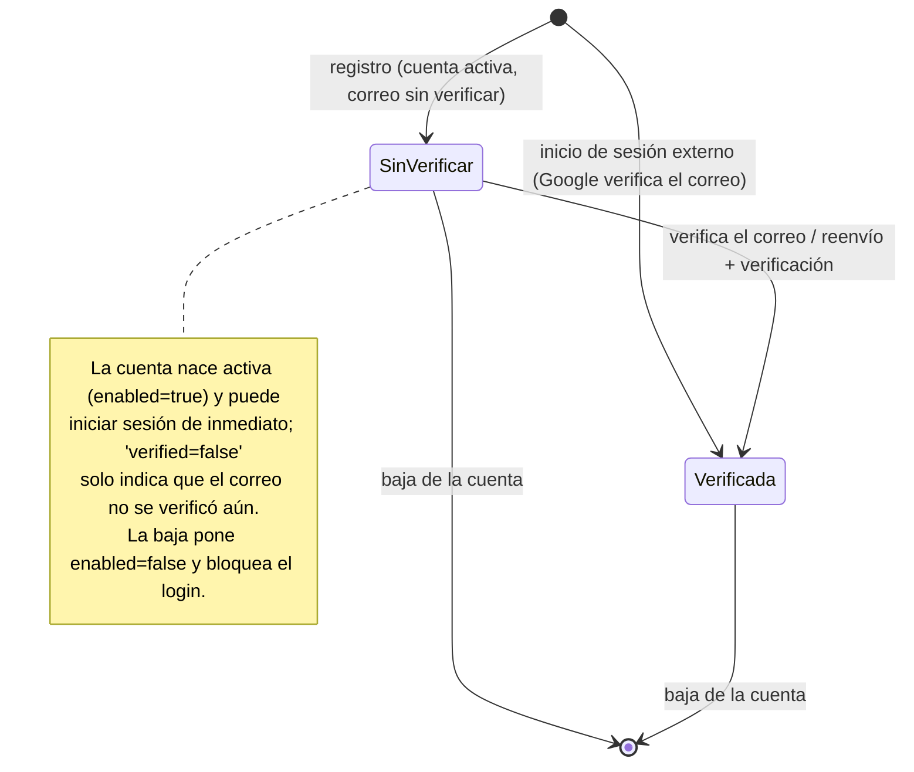

## Versión de un curso

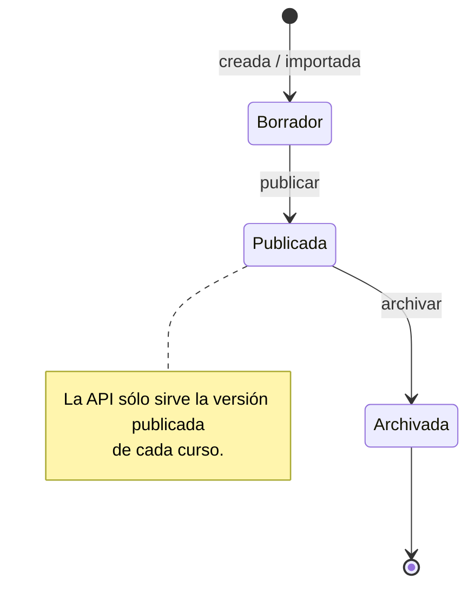

## Inscripción a un curso

Por cuenta propia sólo se puede inscribir en cursos gratuitos; a los pagos se llega a través de una
organización. Una inscripción dada por una organización puede tener fecha de vencimiento: vencida,
deja de dar acceso aunque siga en `Inscripto`.

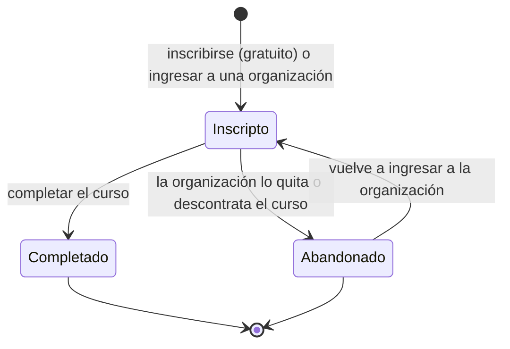

## Organización

Las que crea SIGNA nacen activas; las que se registran solas desde la web quedan pendientes hasta
que SIGNA las revisa desde su panel: al aprobarlas elige en el mismo paso qué cursos contratan.
Mientras no esté activa, su administrador puede entrar al panel, pero no se pueden generar
invitaciones de participantes ni sumarse participantes.

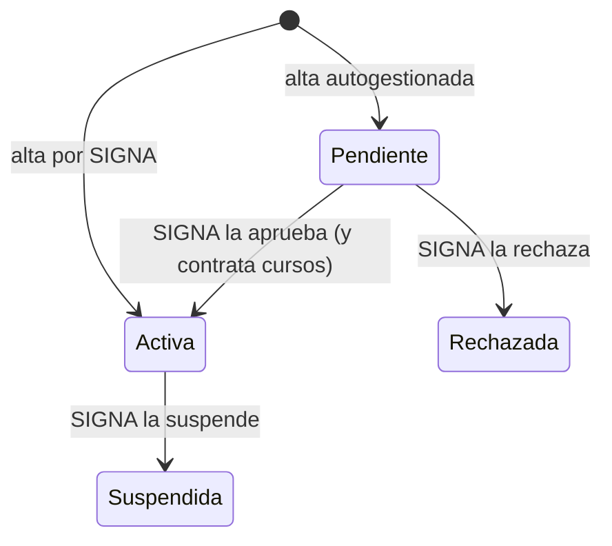

## Membresía en una organización

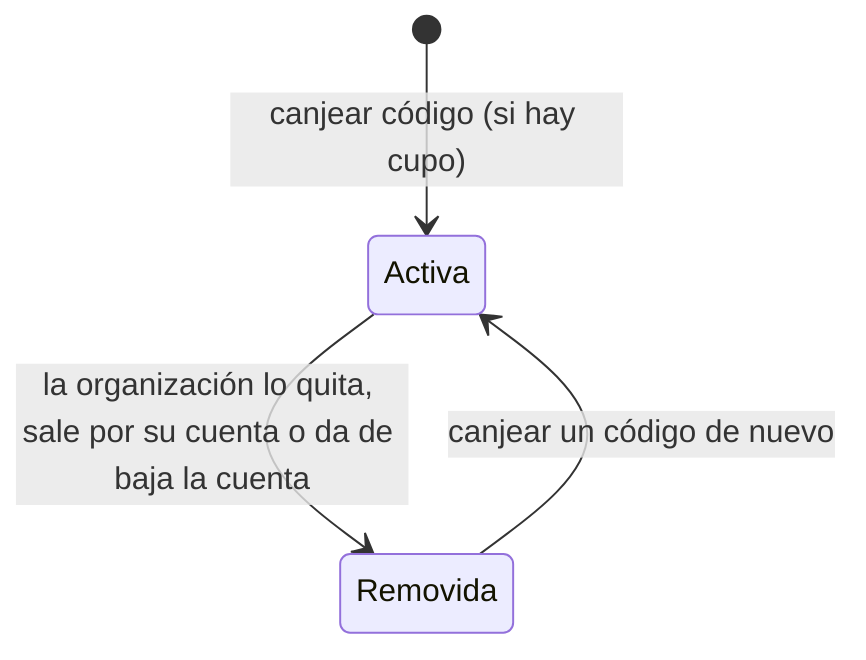

## Progreso de tema y de lección

Mismo ciclo para el avance de un tema y de una lección.

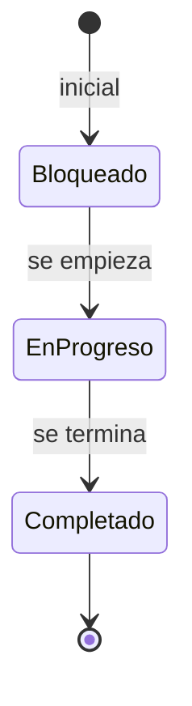

## Solicitud de amistad

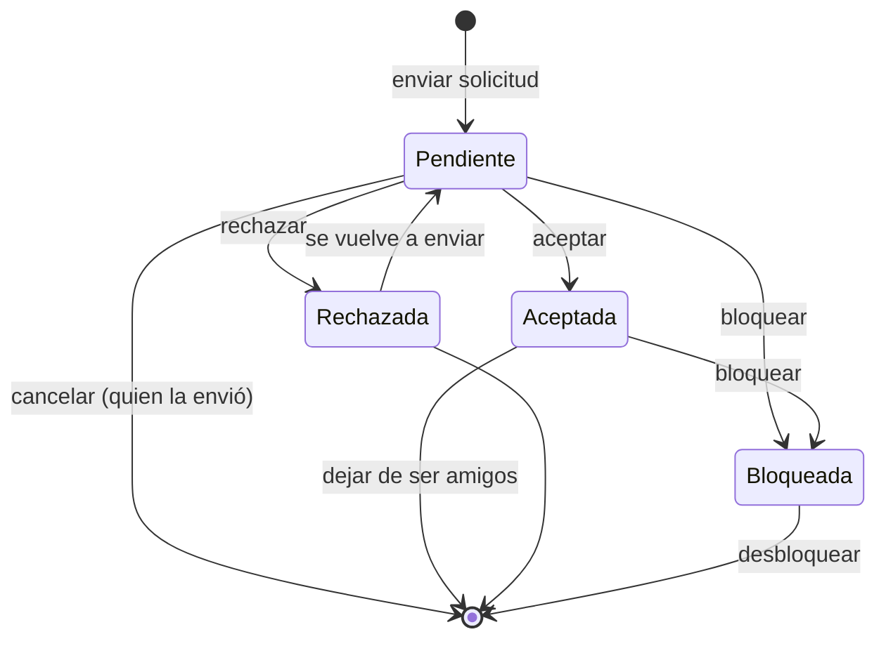

Cancelar, dejar de ser amigos y desbloquear **borran** la relación, así que las dos personas
vuelven a partir de cero. Una solicitud rechazada, en cambio, se conserva y se reutiliza si alguien
vuelve a enviarla.

## Reporte de una seña

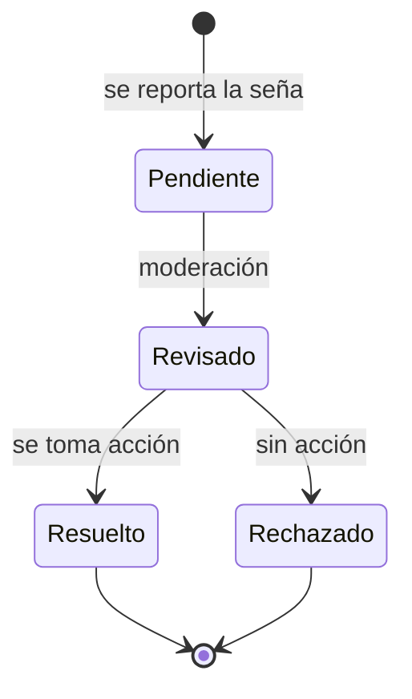

## Regalo entre usuarios

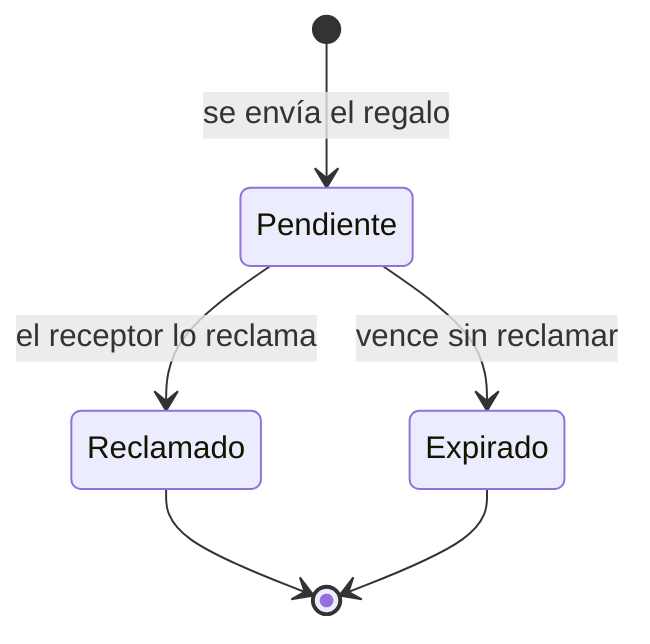

## Ítem comprado o regalado

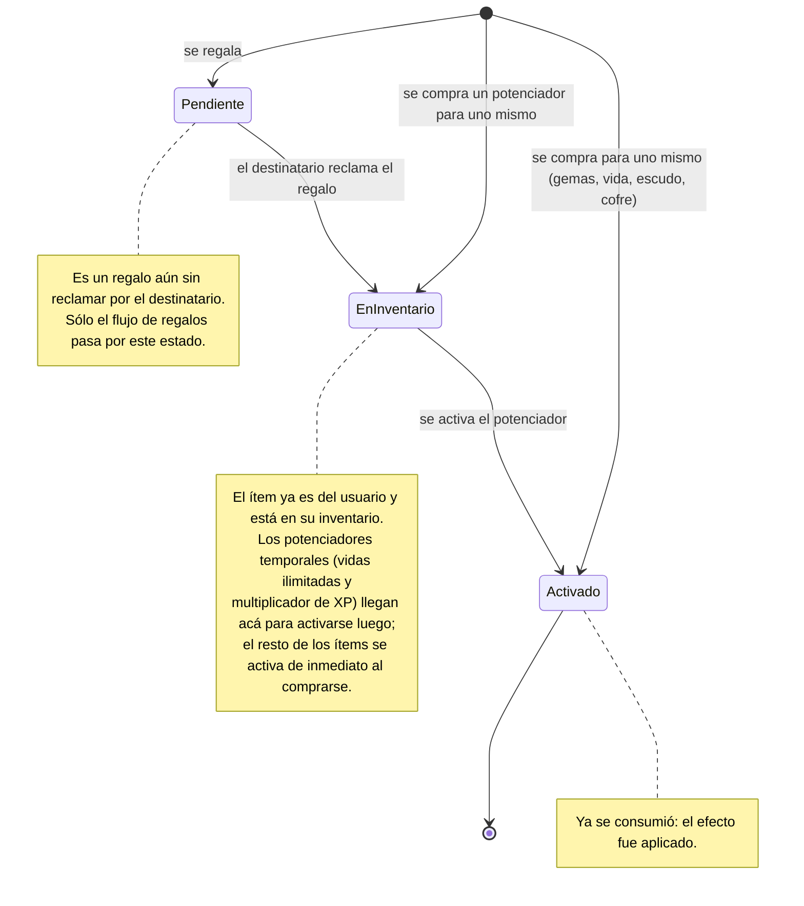

## Resultado de la incorporación de contenido

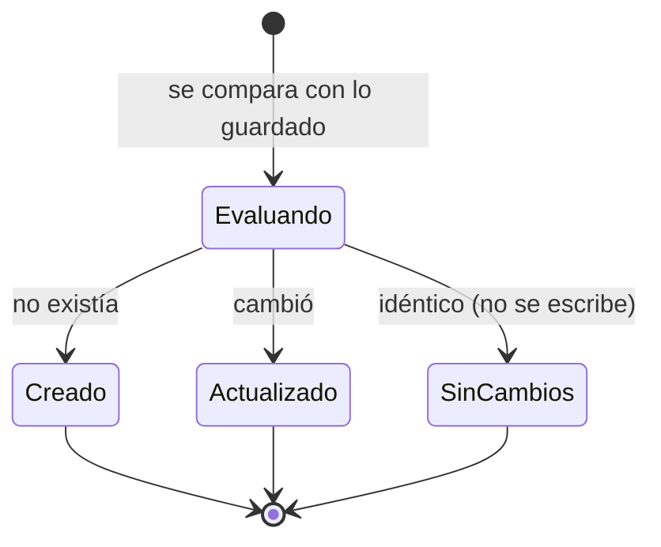
